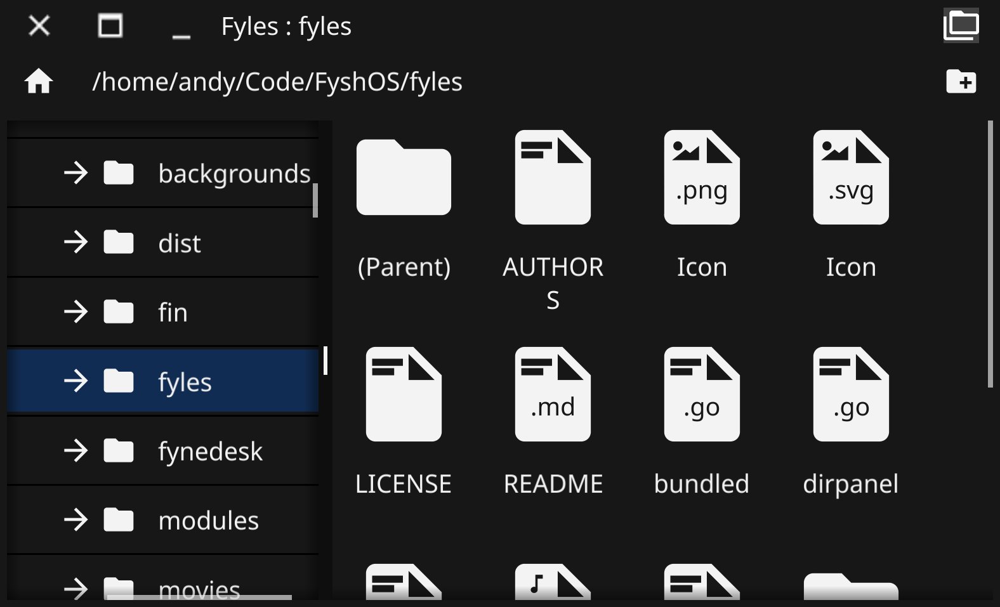

# Fyles

This repo contains the work-in-progress Fyne file browser.

## Usage

Open the Fyles app as a GUI or from the command line.
You can pass command-line argument to specify which folder to open.

## Multiple Panels

By specifying more than one location the Fyles window will open
with multiple panels displayed in a row.

    fyles Code/myProject Code/myOldProject

## Archives

Zip and tar files (including `.tar.gz`, `.tar.bz2`, `.tar.xz` and `.tar.zst`)
are shown with an archive icon and open like folders, in the file list and in
the directory tree. Opening a file from inside an archive extracts it to a
temporary location, which is removed when Fyles exits.
